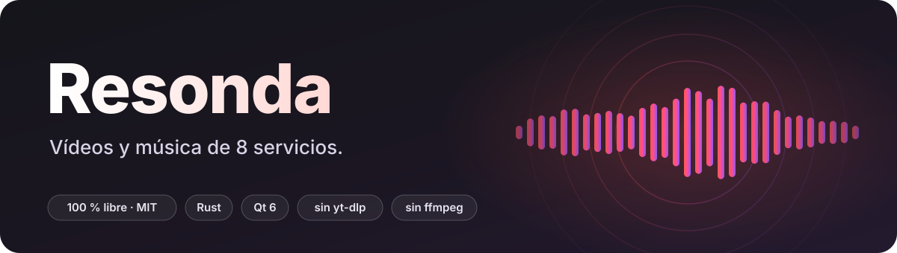
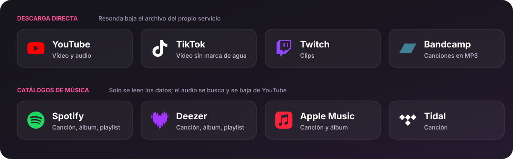
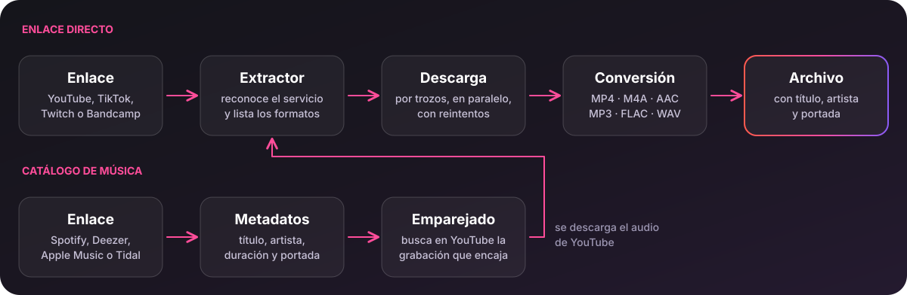

<p align="center">
  
</p>

<p align="center">
  <b>Descarga vídeos y música</b> de YouTube, TikTok, Twitch, Bandcamp, Spotify, Deezer, Apple Music y Tidal<br>
  a MP4, MP3, FLAC, WAV, M4A o AAC. Código propio · 100 % libre (MIT) · sin yt-dlp ni ffmpeg
</p>

<p align="center">
  <a href="https://github.com/macorredor270/resonda/releases/latest"></a>
  <a href="https://github.com/macorredor270/resonda/actions/workflows/ci.yml"></a>
  <a href="LICENSE"></a>
  
  
</p>

<p align="center">
  <a href="#instalar"><b>⬇ Instalar</b></a> ·
  <a href="#uso">Uso</a> ·
  <a href="#servicios-y-formatos">Servicios</a> ·
  <a href="#cómo-funciona">Cómo funciona</a> ·
  <a href="#límites-conocidos">Límites</a> ·
  <a href="#compilar">Compilar</a> ·
  <a href="#desarrollo">Desarrollo</a>
</p>

---

## En 30 segundos

```sh
resonda https://youtu.be/dQw4w9WgXcQ              # vídeo en MP4
resonda -f mp3 -b 256 <enlace de TikTok o YouTube> # audio en MP3 a 256 kbps
resonda -f flac <canción de Deezer o Spotify>      # la busca en YouTube y la guarda con sus etiquetas
```

Si prefieres una ventana, abre `resonda-gui`, pega el enlace, pulsa **Buscar**, elige formato y **Descargar**.

## Instalar

Lo compilado está en [**Releases**](https://github.com/macorredor270/resonda/releases/latest). Cada versión incluye `SHA256SUMS.txt` para comprobar los archivos.

| Sistema | Archivo | Qué es |
|---|---|---|
| **Linux, cualquier distro** | `Resonda-*-x86_64.AppImage` | La ventana, portable (lleva Qt dentro): `chmod +x` y a ejecutar |
| **Debian, Ubuntu y derivadas** | `resonda_*_amd64.deb` | Terminal y ventana: `sudo apt install ./resonda_*_amd64.deb` |
| **Linux, solo terminal** | `resonda-cli-*-linux-x86_64.tar.gz` | Un único binario, sin dependencias |
| **Windows** | `Resonda-*-windows-x64.zip` | `resonda.exe` (terminal) y `resonda-gui.exe` (ventana) |
| **macOS** (Apple Silicon e Intel) | `resonda-cli-*-macos-arm64.tar.gz` / `-macos-x86_64.tar.gz` | Solo terminal |
| **Linux ARM** (Raspberry Pi 4/5, servidores) | `resonda-cli-*-linux-aarch64.tar.gz` | Solo terminal |

> Los paquetes de **macOS y Linux ARM** se publican a partir de la próxima versión (la v1.0.0 trae Linux x86_64 y Windows).
> Mientras tanto puedes [compilar](#compilar) tú mismo: en cualquier sistema, la terminal son dos comandos.

Los binarios de Linux funcionan en cualquier distro con glibc 2.35 o superior (Ubuntu 22.04 en adelante).
Los paquetes se compilan en GitHub Actions, sin nada oculto: el flujo está en [`.github/workflows/release.yml`](.github/workflows/release.yml).

## Uso

### Terminal

```text
resonda [opciones] <URL o ID> [<URL o ID> ...]
```

| Opción | Qué hace |
|---|---|
| `-f`, `--format <fmt>` | `mp4` (vídeo, por defecto), `mp3`, `flac`, `wav`, `m4a` o `aac` |
| `-q`, `--quality <alto>` | Altura máxima del vídeo en píxeles, o `best` (por defecto `1080`) |
| `-b`, `--bitrate <kbps>` | Calidad del MP3: `128`, `192` (por defecto), `256` o `320` |
| `-d`, `--dir <carpeta>` | Carpeta de salida (por defecto la actual) |
| `-o`, `--output <ruta>` | Nombre del archivo de salida (solo con un enlace) |
| `-a`, `--audio` | Atajo de `--format m4a` |
| `-n`, `--limit <N>` | En álbumes y playlists, solo las N primeras canciones |
| `-l`, `--list` | Muestra los formatos (o las canciones) y sale, sin descargar |
| `-S`, `--services` | Lista los servicios soportados |
| `-V`, `--version` · `-h`, `--help` | Versión · ayuda |

Los argumentos se comprueban antes de tocar la red: un formato, una calidad o un `--limit` que no tienen sentido
dan un error al instante. Puedes pasar varios enlaces a la vez. El código de salida es `0` si todo fue bien,
`1` si alguna descarga falló y `2` si los argumentos no valen.

```sh
resonda -l https://www.youtube.com/watch?v=dQw4w9WgXcQ      # qué formatos hay
resonda -q 720 -d ~/Vídeos <enlace>                          # vídeo a 720p en esa carpeta
resonda -f mp3 -n 5 https://www.deezer.com/es/playlist/908622995   # las 5 primeras de una playlist
resonda -f m4a https://clips.twitch.tv/<clip>                # el audio de un clip, sin recodificar
```

Con álbumes y playlists, cada canción se guarda en una carpeta con el nombre de la lista; si dos canciones se llaman
igual, la segunda lleva « (2)» para no pisar a la primera.

### Ventana

`resonda-gui [enlace]` abre la ventana (con un enlace, lo busca al arrancar).

1. **Servicios** (arriba a la derecha): marca los que quieres usar. La pantalla de bienvenida los ofrece la primera vez.
2. Pega el enlace y pulsa **Buscar**: aparecen el título, la duración y la miniatura (o la lista de canciones).
3. Elige **formato**, **calidad del MP3** o **resolución** del vídeo, y la carpeta (**Guardar en**).
4. **Descargar**. Puedes **Cancelar** en cualquier momento: no queda ningún archivo a medias. Al terminar, **Abrir carpeta**.

## Servicios y formatos

<p align="center">
  
</p>

| Servicio | Qué enlaces acepta | MP4 | M4A · AAC | MP3 | FLAC · WAV |
|---|---|---|---|---|---|
| **YouTube** | vídeos, Shorts, `youtu.be`, `music.youtube.com`, ID suelto | H.264 hasta 1080p; AV1 por encima | original | recodificado (128–320 kbps) | decodificados |
| **TikTok** | `tiktok.com/@usuario/video/…`, `vm.` y `vt.tiktok.com/…` | H.264 sin marca de agua | original (HE-AAC) | sonido original, sin recodificar¹ | calidad completa¹ |
| **Twitch** | clips: `clips.twitch.tv/…`, `twitch.tv/canal/clip/…` | de 360p a 1080p | original | recodificado | decodificados |
| **Bandcamp** | una canción: `canal.bandcamp.com/track/…` | — (solo audio) | no² | MP3 de 128 kbps, sin recodificar | decodificados |
| **Spotify**, **Deezer**, **Apple Music**, **Tidal** | canción, álbum o playlist (Apple Music: canción o álbum; Tidal: solo canción) | — | sí³ | sí³ | sí³ |

¹ **TikTok y el HE-AAC.** El audio de sus vídeos es HE-AAC (SBR), que Resonda no sabe decodificar entero (no hay un
decodificador SBR libre en Rust). Para MP3, FLAC y WAV usa el *sonido original* que TikTok publica aparte (MP3 de 128 kbps o
AAC-LC, calidad completa; Resonda decodifica ambos). Si el vídeo lleva música de otra persona, esa pista no es el audio del
vídeo: entonces solo se puede decodificar el núcleo del HE-AAC, que sale mono, a 22 kHz y sin agudos, y la terminal avisa.
**M4A y AAC conservan siempre la calidad original.** Por compatibilidad, el MP4 de TikTok es H.264 aunque haya una versión HEVC más grande.

² Bandcamp entrega MP3; pasarlo a M4A o AAC exigiría recodificarlo, y Resonda no tiene codificador AAC.

³ De estos cuatro catálogos solo se leen los **metadatos** (título, artistas, duración, portada). Su audio está protegido con DRM
y no se toca: cada canción se busca y se descarga desde YouTube, y se guarda con sus etiquetas.

### Cómo se obtiene cada formato

| Formato | De dónde sale | Etiquetas |
|---|---|---|
| **MP4** | El MP4 del servicio. En YouTube, vídeo y audio por separado unidos con nuestro muxer | — |
| **M4A** | El audio AAC original, sin recodificar | título, artista, álbum, año y portada |
| **AAC** | El mismo audio como AAC crudo (ADTS), sin recodificar | — |
| **MP3** | Si el servicio ya da MP3 (Bandcamp, el sonido de TikTok), se guarda tal cual y solo se cambia la etiqueta; si no, se decodifica y se codifica con `rusty_mp3` | ID3v2 con portada |
| **FLAC** | Decodificando el audio; el codificador FLAC es nuestro, sin pérdida | título, artista, álbum, año y portada |
| **WAV** | Decodificando el audio; PCM de 16 bits | título, artista… |

Los audios sacados de un vídeo (TikTok, Twitch, Bandcamp, YouTube) se etiquetan con el título, el autor y la miniatura del servicio.

## Cómo funciona

<p align="center">
  
</p>

Resonda **no usa ni incluye yt-dlp, youtube-dl, ffmpeg, spotDL ni ninguna otra herramienta de descarga**, y no lanza ningún programa
externo (compruébalo: `grep -rn "Command::new" src gui/src` no encuentra nada). Cada pieza es código del proyecto:

| Pieza | Qué hace |
|---|---|
| **Extractores** | Un módulo por servicio ([`src/sources/`](src/sources)): reconoce los enlaces y entrega los formatos. YouTube, TikTok, Twitch y Bandcamp |
| **Catálogos** | Spotify, Deezer, Apple Music y Tidal: leen los datos de un enlace y buscan la grabación que encaja en YouTube (por duración, título y artista) |
| **Cliente de YouTube** | Abre una sesión anónima, elige el cliente que sirve el vídeo completo y busca vídeos |
| **Descargador** | Por trozos y en paralelo, con reintentos y cancelación limpia. Un trozo solo se acepta si llegó completo y es el que se pidió |
| **Muxer MP4** | Lee MP4 fragmentados (YouTube) y normales (TikTok, Twitch); escribe un MP4 normal, o saca solo el audio a M4A |
| **Extractor AAC** | Saca el audio a `.aac` (ADTS) sin recodificar |
| **Codificador FLAC · escritor WAV** | FLAC sin pérdida (predictores fijos, decorrelación estéreo) y PCM de 16 bits |
| **Etiquetas** | Título, artista, álbum, año y portada en MP4/M4A, MP3 (ID3v2), FLAC y WAV |
| **Ventana** | Interfaz Qt/QML con selector de servicios, formatos, progreso y cancelación |

Lo único ajeno son los decodificadores AAC y MP3 y el codificador MP3 (ver [Librerías](#librerías-y-créditos)).
Son unas 5 000 líneas de Rust, más unas 1 400 de ventana y otras 1 600 de pruebas: caben en una tarde de lectura.

## Libre y privado

- **Licencia [MIT](LICENSE)**: úsalo, cópialo, modifícalo, véndelo. No hace falta pedir permiso.
- **Sin cuentas, sin anuncios, sin telemetría.** Resonda solo habla con el servicio del enlace que le das:

  | Servicio | Servidores con los que habla |
  |---|---|
  | YouTube | `www.youtube.com`, sus servidores de vídeo y las miniaturas |
  | TikTok | `www.tiktok.com` y sus servidores de vídeo |
  | Twitch | `gql.twitch.tv` y sus servidores de clips |
  | Bandcamp | la página de la canción y `bcbits.com` |
  | Spotify · Deezer · Apple Music · Tidal | `open.spotify.com`, `api.deezer.com`, `itunes.apple.com`, `tidal.com` (solo para leer los datos), más las portadas |

- Respeta `HTTPS_PROXY` y `ALL_PROXY` si los tienes definidos.
- **Sin nada oculto**: todo el código está aquí y cada versión se compila en GitHub Actions.

## Límites conocidos

Resonda baja lo que cualquiera puede ver sin iniciar sesión y sin saltarse ninguna protección. Por eso:

- **Contenido que exige cuenta**: vídeos privados, solo para miembros o para mayores de edad no se pueden bajar.
- **YouTube sin sesión** a veces corta la descarga a los ~60 s (HTTP 403). Resonda prueba varios clientes y reintenta; si no lo
  consigue, lo dice. No es un fallo del programa.
- **DRM**: lo que un servicio sirve cifrado no se toca. Por eso **Vimeo** no está soportado (sus vídeos públicos van cifrados) y
  de Spotify, Deezer, Apple Music y Tidal solo se leen los datos.
- **Alcance de cada servicio**: Twitch, solo clips (no VODs ni directos); Bandcamp, canciones sueltas (en un álbum, pega el enlace
  de una canción); Apple Music, canciones y álbumes; Tidal, solo canciones; TikTok, solo vídeos (no carruseles de fotos).
- **Sin soporte (por ahora)**: Instagram, Facebook, X, Reddit, SoundCloud y Dailymotion. La ventana los muestra como «Próximamente».
- **Ctrl+C en la terminal** puede dejar un archivo `.part` junto al destino: bórralo sin miedo. En la ventana, **Cancelar** limpia todo.
- Los servicios usan páginas y APIs no oficiales y cambian sin avisar: si uno deja de funcionar, [abre una incidencia](https://github.com/macorredor270/resonda/issues).

## Compilar

Hace falta **Rust**. Para la ventana, además, Qt 6.5 o superior (Quick, QuickControls2 y Svg), CMake y Ninja.

```sh
git clone https://github.com/macorredor270/resonda.git && cd resonda
make cli        # terminal:  target/release/resonda
make gui        # ventana:   gui/build/resonda-gui   (make run la abre)
make test       # pruebas del núcleo
make clean      # borra lo compilado: el proyecto vuelve a ocupar menos de 1 MB
```

`make cli` compila con Rust a secas, sin ninguna dependencia del sistema; Qt solo hace falta para `make gui`.

**Arch / Manjaro / EndeavourOS / CachyOS**

```sh
sudo pacman -S --needed rust qt6-base qt6-declarative qt6-svg cmake ninja
```

**Fedora**

```sh
sudo dnf install rust cargo qt6-qtbase-devel qt6-qtdeclarative-devel qt6-qtsvg-devel cmake ninja-build
```

**openSUSE**

```sh
sudo zypper install rust cargo qt6-base-devel qt6-declarative-devel qt6-svg-devel cmake ninja
```

**Debian / Ubuntu** (compilando en vez de usar el `.deb`)

```sh
sudo apt install cargo qt6-base-dev qt6-declarative-dev libqt6svg6-dev cmake ninja-build
```

**macOS**

```sh
brew install rust qt cmake ninja
cmake -S gui -B gui/build -G Ninja -DCMAKE_PREFIX_PATH="$(brew --prefix qt)" && cmake --build gui/build   # la ventana
```

La terminal se prueba en macOS en cada cambio (CI); la ventana en macOS todavía no.

**Windows**: instala Rust con la cadena de herramientas MSVC y compila desde **PowerShell** (no desde el bash de Git: su
`link.exe` es otro). La terminal es `cargo build --release`; la ventana necesita además Qt, CMake y Ninja.

Si `cmake` no encuentra Qt, exporta `CMAKE_PREFIX_PATH` apuntando a su instalación (p. ej. `~/Qt/6.x/gcc_64`).
Para generar los paquetes de Linux: `packaging/build-linux.sh` (deja `.tar.gz`, `.deb` y AppImage en `dist/`).

## Desarrollo

### Ramas

| Rama | Para qué |
|---|---|
| `main` | Lo estable. Los cambios entran por pull request y tienen que pasar la CI |
| `debug` | Rama de trabajo: aquí se prueban cambios sin tocar `main`. La CI también corre en ella |

```sh
git switch debug                                   # trabajar en debug
git fetch origin && git merge origin/main          # ponerla al día con main
git push                                           # subir tus cambios
gh pr create --base main --head debug              # cuando algo esté listo, pedir pasarlo a main
```

Las versiones se publican subiendo una etiqueta `v*` (por ejemplo `git tag v1.1.0 && git push --tags`): la CI compila los
paquetes de todos los sistemas y los sube a Releases.

### Pruebas

`make test` (o `cargo test --release`) ejecuta unas 90 pruebas que **no necesitan internet**. Cubren:

- **La descarga contra un servidor HTTP falso** ([`src/testutil.rs`](src/testutil.rs)) que se porta mal a propósito: reintenta los
  fallos pasajeros (500, 429, conexión cortada), no reintenta los definitivos (403, 404, 410, 416), no acepta nunca un trozo
  equivocado (servidor que ignora `Range`), respeta «cancelar» también durante las esperas, y comprueba que un fallo **no toca
  un archivo que ya existía ni deja `.part` sueltos**.
- **Archivos dañados**: MP4 (normales y fragmentados) truncados en todas las longitudes y con bytes cambiados, tablas
  incoherentes, MP3 corruptos o basura, y casos límite de WAV y FLAC (vacío, una muestra, número impar…): siempre error, nunca pánico.
- **Ida y vuelta de audio**: un tono se codifica a MP3 y se decodifica, y se comprueba formato, duración y nivel.
- **Páginas y JSON de cada servicio** con miles de variantes dañadas, y 30 000 enlaces aleatorios, para que un cambio en un
  servicio dé un error claro y no un pánico.
- **La línea de comandos**: argumentos válidos y no válidos, rechazados antes de tocar la red.

Los servicios reales no se llaman en las pruebas porque cambian sin avisar; cada uno tiene un ejemplo fijo de su página. Para
comprobar uno de verdad, ejecuta la terminal con un enlace. La CI corre las pruebas en Linux (x86_64 y ARM), Windows y macOS.

### Añadir un servicio

Cada servicio es un tipo que implementa `Extractor` ([`src/sources/mod.rs`](src/sources/mod.rs)):

```rust
pub struct MiRed;
impl Extractor for MiRed {
    fn id(&self) -> &'static str { "mired" }
    fn name(&self) -> &'static str { "MiRed" }
    fn matches(&self, input: &str) -> bool { on_domain(input, "mired.com") }   // sin usar la red
    fn extract(&self, agent: &ureq::Agent, input: &str) -> Res<VideoInfo> { /* ... */ }
}
```

1. `extract` devuelve un `VideoInfo` con los formatos (`Kind::Muxed` para MP4 completos con vídeo y audio, o `Video` + `Audio`
   por separado, o un audio suelto) y las cabeceras que el servicio exige al descargar (`Referer`, `Cookie`…).
2. Añádelo a `EXTRACTORS`: la terminal, la API C y la ventana ya lo usan.
3. En la ventana, añade además su tarjeta a `live` en [`gui/qml/ServiceSetup.qml`](gui/qml/ServiceSetup.qml).
4. Escribe su prueba con un ejemplo fijo de la página, como en [`tiktok.rs`](src/sources/tiktok.rs) (el más corto).

Los servicios que solo aportan metadatos (como Deezer) implementan `Catalog` ([`src/sources/catalog.rs`](src/sources/catalog.rs)) en vez
de `Extractor`; su audio se busca en YouTube.

Si añades un servicio, regenera los gráficos con `python3 docs/make-assets.py` (solo usa la biblioteca estándar).

### Estructura

```
.
├── Cargo.toml · Cargo.lock · Makefile · LICENSE
├── .github/workflows/           ci.yml (pruebas) · release.yml (paquetes de todos los sistemas)
├── docs/                        gráficos del README · make-assets.py los regenera
├── include/resonda.h            API C pública (la usa la ventana)
├── packaging/                   script de paquetes de Linux
├── src/                         núcleo en Rust
│   ├── main.rs                  línea de comandos
│   ├── lib.rs · ffi.rs · pipeline.rs · io.rs · testutil.rs
│   ├── sources/                 mod (trait Extractor) · catalog (trait Catalog) · download · matching
│   │                            youtube · tiktok · twitch · bandcamp · spotify · deezer · apple · tidal
│   └── media/                   pcm · wav · flac · mp3 · tags · container
│       └── mp4/                 muxer MP4 (boxes, track, build, ilst, aac)
└── gui/                         ventana Qt6 / QML
    ├── src/                     capa C++ entre QML y el núcleo
    ├── qml/                     Main.qml · ServiceSetup.qml
    ├── assets/logos/            logos de los servicios (se incrustan en el binario)
    └── data/                    resonda.desktop · resonda.svg (icono)
```

## Librerías y créditos

Solo cinco dependencias directas (unos 45 crates en total en Linux, casi todos TLS y utilidades) y Qt para la ventana:

| Librería | Para qué | Licencia |
|---|---|---|
| [`ureq`](https://crates.io/crates/ureq) | HTTPS (con `rustls`, sin OpenSSL) | MIT / Apache-2.0 |
| [`serde_json`](https://crates.io/crates/serde_json) | Leer las respuestas JSON | MIT / Apache-2.0 |
| [`symphonia-codec-aac`](https://crates.io/crates/symphonia-codec-aac), [`symphonia-bundle-mp3`](https://crates.io/crates/symphonia-bundle-mp3) y `symphonia-core` | **Solo** decodificar AAC y MP3 (para WAV, FLAC y MP3) | MPL-2.0 |
| [`rusty_mp3`](https://crates.io/crates/rusty_mp3) | Codificar MP3 | Apache-2.0 |
| [Qt 6](https://www.qt.io) (Quick, QuickControls2, Svg) | La ventana. Se enlaza dinámicamente | LGPL-3.0 |
| [Simple Icons](https://simpleicons.org) | Logos de los servicios | CC0-1.0 |

Los paquetes AppImage, `.deb` y Windows llevan Qt sin modificar; para cambiarlo basta con sustituir sus bibliotecas. Puedes ver
todas las dependencias con `cargo tree`. Los logos son marcas registradas de sus dueños: se usan solo para identificar cada
servicio y Resonda no está afiliada a ninguno.

**De dónde viene el conocimiento.** Para entender cómo funcionan los clientes de YouTube estudiamos [yt-dlp](https://github.com/yt-dlp/yt-dlp)
(Unlicense) y para la idea de emparejar canciones de Spotify con vídeos, [spotDL](https://github.com/spotDL/spotify-downloader) (MIT).
Gracias a ambos proyectos. La lógica se reescribió desde cero en Rust: aquí no hay código suyo.

## Aviso legal

Descargar contenido puede ir contra las condiciones de uso de cada servicio, y lo que descargues tiene sus propios derechos:
úsalo con lo que sea tuyo o tengas permiso de guardar. De Spotify, Deezer, Apple Music y Tidal **solo se leen los datos** (título,
artistas, portada); su audio, que está protegido con DRM, no se toca: cada canción se busca y se baja de YouTube.

## Licencia

[MIT](LICENSE) © 2026 Resonda contributors.
